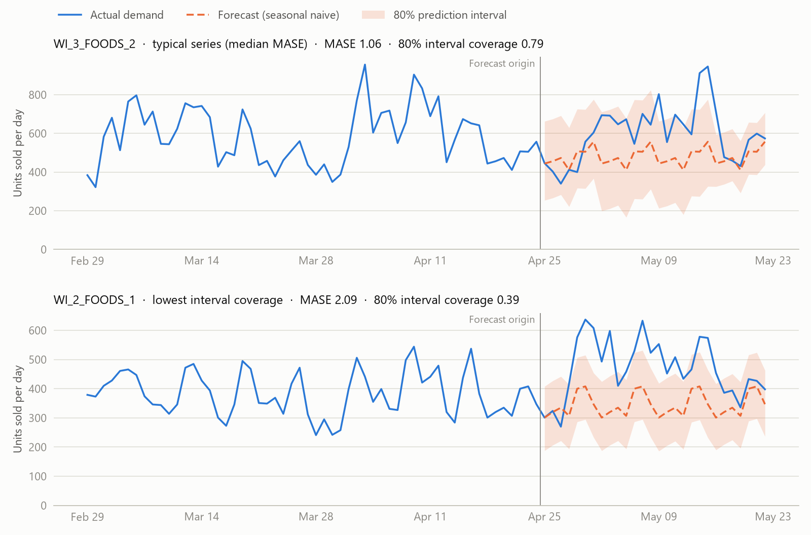

# Probabilistic Demand Forecasting: Time-Series Foundation Models vs. Strong Baselines

[](https://github.com/akrambouznad789-cyber/demand-forecasting-benchmark/actions/workflows/tests.yml)

[](LICENSE)

A reproducible benchmark of zero-shot time-series foundation models (Chronos, TimesFM, TabPFN-TS) against
classical baselines on retail demand (M5, Walmart). Point forecasts are scored with MASE; probabilistic forecasts
with the scaled quantile loss and the coverage of the 80% prediction interval. For inventory decisions, the question
is not only whether the forecast is accurate, but whether its intervals can be trusted to set safety stock.

> **Status: work in progress** (started October 2026). Done: data pipeline, metrics with unit tests, and a seasonal
> naive baseline with empirical prediction intervals. Next: ETS and LightGBM baselines, then the foundation models.
> See the [roadmap](#roadmap).

## Research question
Do zero-shot time-series foundation models forecast retail demand better than strong classical baselines, and are
their prediction intervals calibrated enough to set inventory on?

## Hypotheses
- **H1.** On aggregated store × department series (smooth, strongly weekly), foundation models beat the seasonal
  naive and ETS baselines on MASE and on the scaled quantile loss.
- **H2.** On item-level series (intermittent demand, many zero-sale days), their advantage shrinks or reverses.
- **H3.** Their 80% prediction intervals are miscalibrated (coverage far from 0.80) on intermittent series, which
  matters for safety stock.

## Results so far
One forecast origin, 70 store × department series, 28-day horizon (2016-04-25 to 2016-05-22). Lower is better for
MASE and the quantile loss; coverage should be close to 0.80.

| Model | MASE | Scaled quantile loss | 80% interval coverage |
|---|---:|---:|---:|
| Seasonal naive + empirical quantiles | 1.150 | 0.364 | 0.807 |

| Category | Series | MASE | Scaled quantile loss | 80% interval coverage |
|---|---:|---:|---:|---:|
| FOODS | 30 | 1.189 | 0.372 | 0.793 |
| HOBBIES | 20 | 1.156 | 0.366 | 0.807 |
| HOUSEHOLD | 20 | 1.087 | 0.349 | 0.827 |

<picture>
  <source media="(prefers-color-scheme: dark)" srcset="figures/forecast_examples_dark.png">
  
</picture>

*Figure 1. Two series picked by rule, not by eye: the series with the median MASE (top) and the series with the
lowest interval coverage (bottom). Regenerate with `python plot_forecasts.py`.*

**What the baseline already shows**
- On average, the empirical intervals are well calibrated: 0.807 coverage for a 0.80 target.
- The average hides a wide spread. Coverage ranges from 0.39 to 1.00 across series, with an interquartile range of
  0.75 to 0.89.
- The worst cases are FOODS departments: CA_2_FOODS_2 has the highest MASE (2.40), and WI_2_FOODS_1 the lowest
  coverage (0.39).
- On WI_2_FOODS_1, demand stepped up right after the forecast origin. A method that repeats last week cannot see a
  level shift, so 17 of the 28 actual values fall above its interval (none below). Whether foundation models handle such shifts better
  is part of H1, and these series are the first cases for the error analysis.

## Experimental protocol

### Data
- **M5** (Makridakis et al., 2022a): daily unit sales of 3,049 Walmart products in 10 stores across California,
  Texas and Wisconsin, from 2011-01-29 to 2016-05-22 (1,941 days).
- **Level studied:** store × department, level 9 of the M5 hierarchy (10 stores × 7 departments = 70 series).
  Item-level series come next (H2, H3).
- The data are downloaded at run time from [Nixtla's public mirror](https://github.com/Nixtla/m5-forecasts) of the
  competition files and are not redistributed here.

### Evaluation split
A single forecast origin: models are fit on days 1 to 1,913 (through 2016-04-24) and forecast the last 28 days, the
M5 horizon. Several rolling origins are on the roadmap.

### Metrics
Let $y_1, \dots, y_n$ be the training history, $h = 28$ the horizon and $m = 7$ the season length. Every error is
divided by the in-sample error of the seasonal naive forecast, so series of very different volumes can be averaged:

$$s = \frac{1}{n-m} \sum_{t=m+1}^{n} \lvert y_t - y_{t-m} \rvert$$

- **MASE** (Hyndman & Koehler, 2006): $\frac{1}{h} \sum_{t=n+1}^{n+h} \lvert y_t - \hat{y}_t \rvert \, / \, s$.
- **Scaled quantile (pinball) loss** over $Q = \lbrace 0.1, 0.5, 0.9 \rbrace$:
  $\frac{1}{\lvert Q \rvert} \sum_{q \in Q} \frac{1}{h} \sum_{t} \rho_q\big(y_t - \hat{y}^{(q)}_t\big) \, / \, s$,
  with $\rho_q(u) = \max\big(q\,u, \, (q-1)\,u\big)$. Averaged over many evenly spaced quantiles, twice this
  quantity approximates the CRPS (Gneiting & Raftery, 2007).
- **80% interval coverage:** the share of test days with $\hat{y}^{(0.1)}_t \le y_t \le \hat{y}^{(0.9)}_t$.
- Scores are averaged over series without weights.

**Differences from the official M5 metrics**, so these numbers are not compared to the leaderboard by mistake:
M5 scales errors by the one-step naive forecast ($m = 1$), uses squared errors for accuracy (RMSSE), nine quantiles
for uncertainty, and weights series by sales value (Makridakis et al., 2022a, 2022b). The seasonal scale is used
here because every store × department series has a strong weekly cycle.

### Baseline
**Seasonal naive with empirical quantiles.** Each forecast day repeats the value observed on the same weekday of the
last training week. The prediction interval comes from the errors this same rule made over the last 364 training
days, measured separately for 1, 2, 3 and 4 weeks ahead because errors grow with the horizon. These quantiles are
added to the point forecast and clipped at zero. Only training data are used, so nothing leaks from the test window.

### Models to compare (next)
ETS and LightGBM as strong classical baselines; Chronos (Ansari et al., 2024), TimesFM (Das et al., 2024) and
TabPFN-TS (Hoo et al., 2025), a prior-data fitted network (Müller et al., 2022), all in zero-shot mode.

## Reproducing the results
Requires Python 3.12 or later. After the one-time download (about 50 MB), the benchmark runs in about 10 seconds on a
standard CPU. The pipeline is deterministic: re-running it produces byte-identical result files.

```bash
git clone https://github.com/akrambouznad789-cyber/demand-forecasting-benchmark.git
cd demand-forecasting-benchmark
python -m venv .venv
source .venv/bin/activate          # Windows: .venv\Scripts\activate
pip install -r requirements.txt
python run_benchmark.py            # downloads M5 on the first run, then writes results/
python plot_forecasts.py           # regenerates figures/
```

Expected output of `run_benchmark.py`:
```
70 series, test window 2016-04-25 to 2016-05-22
mase                    1.150
scaled_quantile_loss    0.364
coverage_80             0.807

By category:
            mase  scaled_quantile_loss  coverage_80
category
FOODS      1.189                 0.372        0.793
HOBBIES    1.156                 0.366        0.807
HOUSEHOLD  1.087                 0.349        0.827
```

### Tests
```bash
pip install -r requirements-dev.txt
pytest
```
The tests check each metric against values computed by hand, and the baseline on series whose correct forecast is
known in advance. GitHub Actions runs them on every push.

## Repository structure
```
├── forecasting/
│   ├── data.py          # M5 download and store × department aggregation
│   ├── baselines.py     # seasonal naive with empirical quantiles
│   └── metrics.py       # MASE, scaled quantile loss, interval coverage
├── tests/               # unit tests (pytest)
├── run_benchmark.py     # forecasts the test window and writes results/
├── plot_forecasts.py    # draws figures/
├── results/             # scores and forecasts per model (CSV)
└── figures/
```

## Roadmap
- [x] Data pipeline, metrics with unit tests, seasonal naive baseline with empirical quantiles
- [ ] ETS and LightGBM baselines
- [ ] Zero-shot Chronos, TimesFM and TabPFN-TS (PyTorch, GPU)
- [ ] Rolling origins; item-level intermittent series (H2, H3)
- [ ] Experiment tracking (TensorBoard) and a tested Docker image
- [ ] Error analysis and a short technical report

## Related project
[forecast-quality-agent](https://github.com/akrambouznad789-cyber/forecast-quality-agent): an LLM agent that answers
planners' questions about these forecasts by calling tools, evaluated against reference answers.

## References
- Ansari, A. F., et al. (2024). Chronos: Learning the language of time series. *Transactions on Machine Learning
  Research*. [arXiv:2403.07815](https://arxiv.org/abs/2403.07815)
- Das, A., Kong, W., Sen, R., & Zhou, Y. (2024). A decoder-only foundation model for time-series forecasting.
  *ICML 2024*. [arXiv:2310.10688](https://arxiv.org/abs/2310.10688)
- Gneiting, T., & Raftery, A. E. (2007). Strictly proper scoring rules, prediction, and estimation. *Journal of the
  American Statistical Association*, 102(477), 359–378. https://doi.org/10.1198/016214506000001437
- Hoo, S. B., Müller, S., Salinas, D., & Hutter, F. (2025). From tables to time: Extending TabPFN-v2 to time series
  forecasting. [arXiv:2501.02945](https://arxiv.org/abs/2501.02945)
- Hyndman, R. J., & Koehler, A. B. (2006). Another look at measures of forecast accuracy. *International Journal of
  Forecasting*, 22(4), 679–688. https://doi.org/10.1016/j.ijforecast.2006.03.001
- Makridakis, S., Spiliotis, E., & Assimakopoulos, V. (2022a). M5 accuracy competition: Results, findings, and
  conclusions. *International Journal of Forecasting*, 38(4), 1346–1364.
  https://doi.org/10.1016/j.ijforecast.2021.11.013
- Makridakis, S., Spiliotis, E., Assimakopoulos, V., Chen, Z., Gaba, A., Tsetlin, I., & Winkler, R. L. (2022b).
  The M5 uncertainty competition: Results, findings and conclusions. *International Journal of Forecasting*, 38(4),
  1365–1385. https://doi.org/10.1016/j.ijforecast.2021.10.009
- Müller, S., Hollmann, N., Pineda Arango, S., Grabocka, J., & Hutter, F. (2022). Transformers can do Bayesian
  inference. *ICLR 2022*. [arXiv:2112.10510](https://arxiv.org/abs/2112.10510)

## Citation
If this benchmark is useful in your work, please cite it using [CITATION.cff](CITATION.cff) (GitHub's
"Cite this repository" button).

## License
The code is released under the [MIT License](LICENSE). The M5 data belong to their providers; `results/` contains
only store × department aggregates and the forecasts derived from them.

## Author
Akram Bouznad, research master's student (M.A.Sc.) in industrial engineering, data science profile, Polytechnique
Montréal · [LinkedIn](https://www.linkedin.com/in/akram-bouznad-68aa7b292/)
